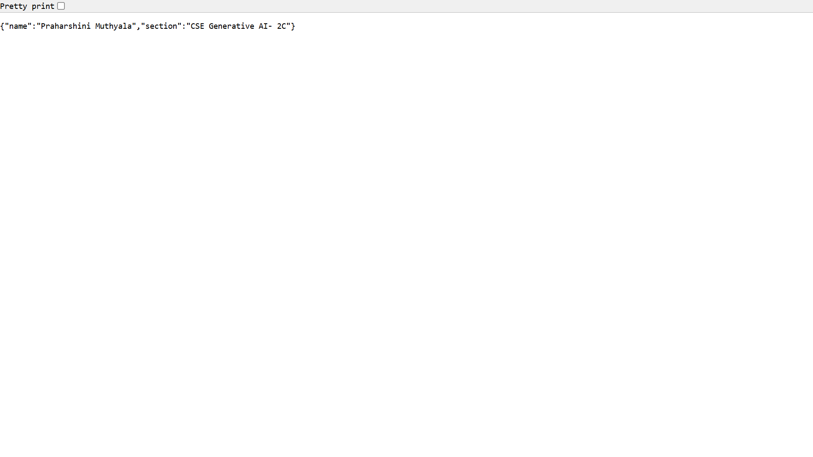
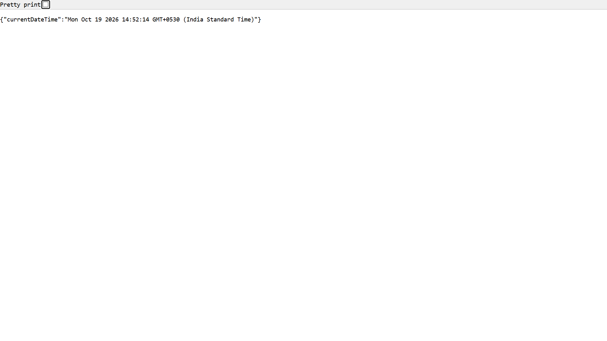

# Lab 1: Node.js and Express server

**Name:** Praharshini Muthyala 
**Registration Number:** 252U1R9132  
**Section:** CSE Generative AI - 2C

## Live Link

Not deployed yet.

## Objective

To create a Node.js HTTP server using the built-in HTTP module and an Express server with routes that return text, JSON, current date and time, and a 404 response for unknown paths.

## Technologies Used

- Node.js
- Express.js
- JavaScript
- npm

## Installation and Setup

### Prerequisites

Install Node.js and npm.

### Steps

1. Clone the repository.
2. Navigate to the lab-01 folder.
3. Install dependencies:

```bash
npm install
```

4. Start the Express server:

```bash
node server.js
```

5. Open `http://localhost:3000` in your browser.

To run the plain Node.js HTTP server, use:

```bash
node http-server.js
```

### Environment Variables

No environment variables are required for local execution. The server uses port 3000 by default and accepts `PORT` when provided by the environment.

## Endpoints

| Method | Path | Description | Status |
|---|---|---|---|
| GET | `/` | Returns a welcome message | 200 |
| GET | `/about` | Returns student information in JSON | 200 |
| GET | `/time` | Returns the current date and time | 200 |
| GET | `/unknown` | Example of an unknown route | 404 |

## Screenshots

### Home Route


### About Route


### Time Route


### 404 Not Found


## package.json Explanation

- `name`: Name of the project.
- `version`: Current project version.
- `description`: Short description of the project.
- `main`: Package entry-point metadata.
- `scripts`: Defines commands that can be run using npm.
- `keywords`: Search terms associated with the package.
- `author`: Project author's name.
- `license`: License identifier.
- `dependencies`: Packages required by the project, including Express.

## Problems Faced and Solutions

Document the actual issues encountered during development and how they were resolved.

## Result

Successfully created and tested a plain Node.js HTTP server and an Express server with the required routes and 404 handling.
