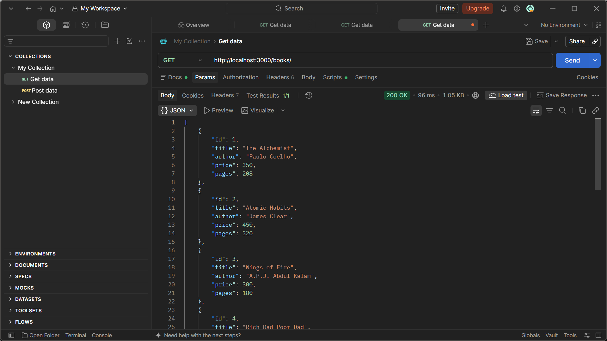
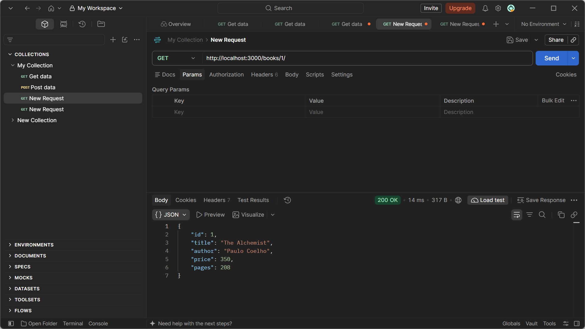
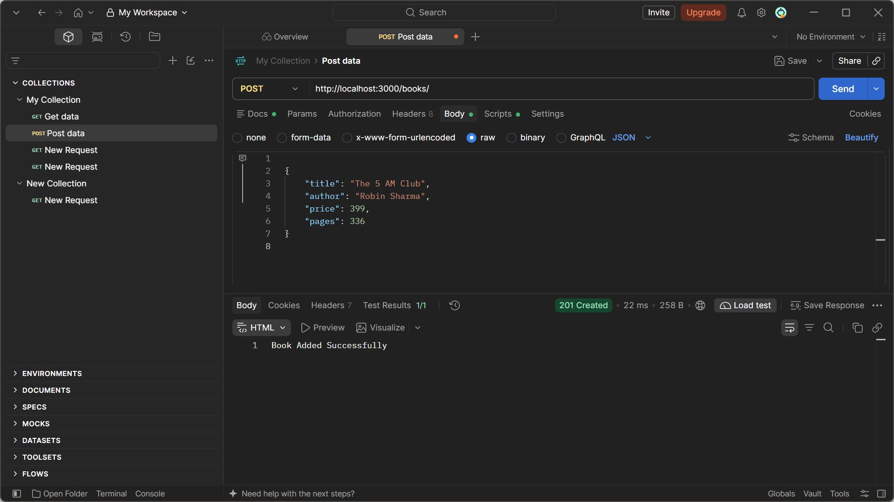
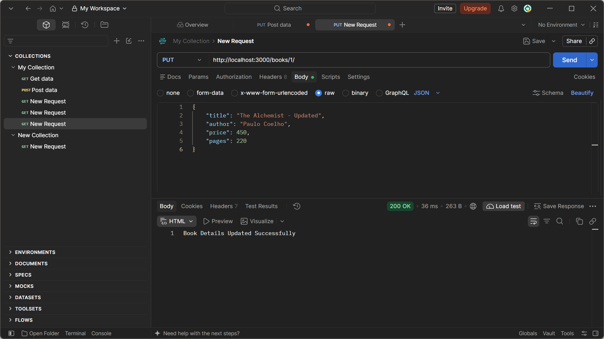
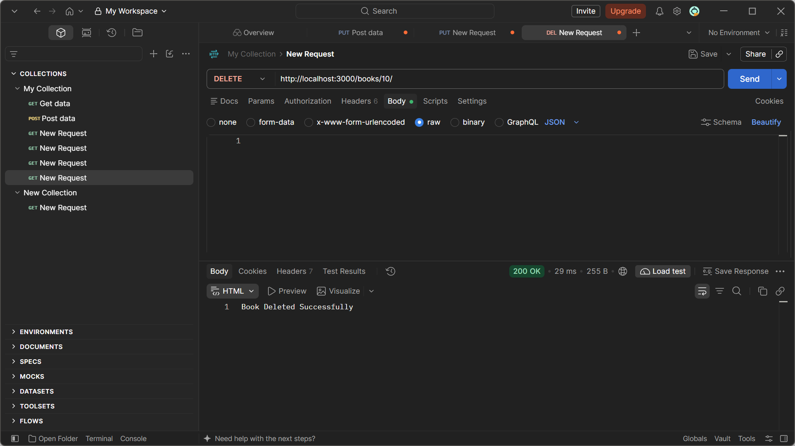
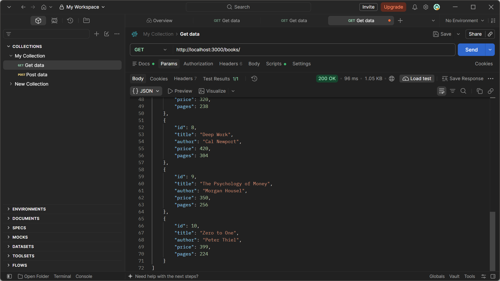

# Lab 2: SQLite Database and CRUD Routes

**Name:** Praharshini Muthyala  
**Section:** CSE Generative AI - 2C

## Objective

To connect an Express server to an SQLite database and implement CRUD (Create, Read, Update, Delete) operations through HTTP API endpoints.

## Technologies Used

- Node.js
- Express.js
- SQLite
- SQLite3
- JavaScript
- Postman

## Project Structure

```text
lab-02/
├── database/
│   └── books.db
├── screenshots/
│   ├── get-all-books.png
│   ├── get-book-by-id.png
│   ├── get-books-status.png
│   ├── database-records.png
│   ├── post-book.png
│   ├── put-book.png
│   └── delete-book.png
├── app.js
├── package.json
├── package-lock.json
└── README.md
```

## Database Structure

The SQLite database contains a table named `book` with the following columns:

| Column | Data Type | Description |
|---|---|---|
| id | INTEGER | Unique book ID and primary key |
| title | TEXT | Name of the book |
| author | TEXT | Name of the author |
| price | INTEGER | Price of the book |
| pages | INTEGER | Number of pages |

Initially, 10 book records were inserted into the database.

## API Endpoints

### 1. Get All Books

- **Method:** GET
- **Endpoint:** `/books/`
- **Description:** Retrieves all book records from the database.
- **Status Code:** 200 OK



### 2. Get Book by ID

- **Method:** GET
- **Endpoint:** `/books/:bookId/`
- **Description:** Retrieves a particular book using its ID.
- **Success Status:** 200 OK
- **Not Found Status:** 404 Not Found



### 3. Add a New Book

- **Method:** POST
- **Endpoint:** `/books/`
- **Description:** Inserts a new book record into the database.
- **Status Code:** 201 Created



### 4. Update Book Details

- **Method:** PUT
- **Endpoint:** `/books/:bookId/`
- **Description:** Updates the details of an existing book using its ID.
- **Status Code:** 200 OK



### 5. Delete a Book

- **Method:** DELETE
- **Endpoint:** `/books/:bookId/`
- **Description:** Deletes a particular book from the database using its ID.
- **Status Code:** 200 OK



## SQL Query Verification

The database records were verified using SQLite CLI.

```sql
SELECT * FROM book;
```

The total number of records was checked using:

```sql
SELECT COUNT(*) FROM book;
```



## How to Run the Project Locally

1. Clone or download the project repository.
2. Open the project folder in VS Code.
3. Install the required dependencies:

```bash
npm install
```

4. Start the development server:

```bash
npm run dev
```

5. Open the following URL in your browser or test it using Postman:

```text
http://localhost:3000/books/
```

## Testing

All five CRUD API endpoints were tested using Postman. The database operations were also verified using SQLite CLI to ensure that records were inserted, retrieved, updated, and deleted correctly.

## Conclusion

This lab provided practical experience in building a backend application using Node.js and Express.js, connecting an SQLite database, executing SQL queries, and implementing CRUD operations through REST API endpoints. It also helped in understanding asynchronous programming, parameterized SQL queries, and API testing using Postman.